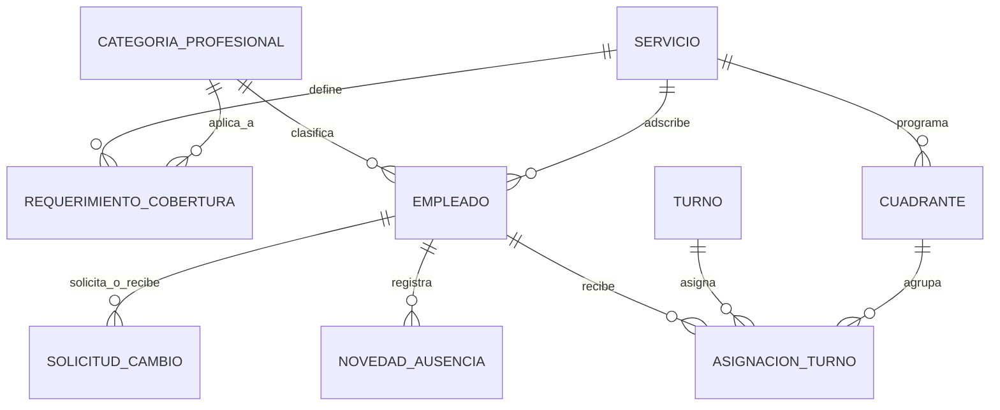

# 04. Modelo Conceptual y Reglas de Negocio

## 1. Diagrama Entidad-Relación Conceptual

---

## 2. Descripción de Entidades Principales

1. **Servicio (Unidad Asistencial Hospitalaria)**:
   - Unidad médica u operativa directa (ej. "Urgencias Generales", "UCI Adultos", "Cirugía General", "Hospitalización", "Laboratorio").
   - Es el centro de la programación: los cuadrantes y las coberturas se definen a este nivel directo (sin dependencias, procesos ni subprocesos).

2. **Categoría Profesional**:
   - Clasificación técnica del personal (ej. Médico Especialista Pediatría, Enfermero Jefe, Auxiliar de Enfermería).
   - Imprescindible para garantizar que los intercambios de turno solo se hagan entre pares equivalentes.

3. **Empleado**:
   - Datos personales, tipo de vinculación, jornada contratada (horas/semana), dependencia base.
   - Rol en el sistema: `ADMIN`, `SUPERVISOR_SERVICIO`, `PERSONAL_ASISTENCIAL`.

4. **Turno**:
   - Plantilla horaria identificada por un código (`M`, `T`, `N`, `G12`, `L`, `S`).
   - Define hora de inicio, hora de fin, total de horas ordinarias y nocturnas.

5. **Cuadrante (Planificación Mensual)**:
   - Representa el conjunto de turnos planificados para una Dependencia en un periodo específico (Año / Mes).
   - Posee estado: `BORRADOR`, `PUBLICADO`, `CERRADO`.

6. **Asignación de Turno**:
   - Asocia a un Empleado con un Turno en una Fecha determinada dentro de un Cuadrante.
   - Registra si el turno fue programado inicialmente o surgió por un cambio/refuerzo.

7. **Requerimiento de Cobertura**:
   - Define el estándar asistencial: "Para el servicio *UCI Adultos*, en el turno *Noche* de los *Sábados*, se requieren al menos *4 Auxiliares de Enfermería* y *2 Médicos*".

8. **Novedad / Ausencia**:
   - Incapacidad médica (con código CIE-10 opcional), vacaciones autorizadas, permisos o licencias.

9. **Solicitud de Cambio de Turno**:
   - Registra la petición entre el Empleado Solicitante y el Empleado Receptor para una fecha y turno determinados, junto con el estado del trámite (`PENDIENTE`, `APROBADO`, `RECHAZADO`).

---

## 3. Matriz de Reglas de Negocio (RN)

| Código | Nombre de la Regla | Nivel de Severidad | Comportamiento del Sistema |
|---|---|---|---|
| **RN-01** | **Descanso entre turnos** | Bloqueante / Advertencia Alta | Debe existir un mínimo de 12h entre la salida de un turno y la entrada del siguiente. En el cuadrante se muestra en rojo y solicita confirmación con justificación si el supervisor decide forzarlo. |
| **RN-02** | **Protección post-guardia** | Bloqueante | Quien finaliza un turno nocturno de 12h o guardia de 24h debe tener automáticamente asignado `S` (Saliente) o `L` (Libre) al día siguiente. No se puede programar turno de mañana ni tarde inmediato. |
| **RN-03** | **Incompatibilidad por Novedad** | Bloqueante Estricto | No se puede asignar ningún turno a un empleado con incapacidad activa, licencia o periodo de vacaciones aprobado. La celda en la matriz se bloquea visualmente. |
| **RN-04** | **No simultaneidad** | Bloqueante Estricto | Un empleado no puede tener asignados dos turnos activos que se solapen en la misma fecha, ni en el mismo servicio ni en otro distinto. |
| **RN-05** | **Equivalencia de perfil en cambios** | Bloqueante | Un intercambio de turnos solo puede iniciarse entre colaboradores de la misma Categoría Profesional y con competencias clínicas equivalentes para el servicio. |
| **RN-06** | **Validación previa del cambio** | Bloqueante | Antes de enviar una solicitud de cambio al supervisor, el sistema simula el cuadrante resultante y rechaza automáticamente la solicitud si causara ruptura de descanso o superación de horas legales. |
| **RN-07** | **Umbral de cobertura mínima** | Informativo / Alerta | El cuadrante calcula dinámicamente si los turnos asignados cubren los requerimientos. Si falta personal, la columna/turno resalta en color ámbar/rojo indicando el déficit exacto (ej. `-1 Enfermero`). |
| **RN-08** | **Tope de jornada legal** | Alerta Preventiva | Al programar turnos que superen el límite legal mensual (calculado con base en la Ley 2101 de 2021), el contador de horas del colaborador cambia a advertencia, indicando necesidad de autorización de horas extras. |
