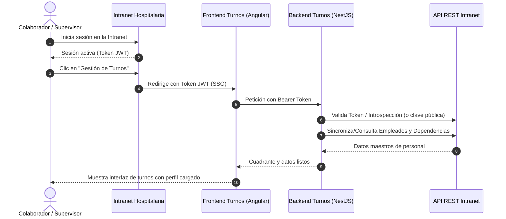

# 06. Modelo de Integración con la Intranet Hospitalaria

## 1. Visión General del Acoplamiento
**Rafa Turnos** opera como un **servicio satélite especializado** desacoplado de la intranet principal del hospital. Esto garantiza que la lógica compleja de cuadrantes y rotaciones no sobrecargue la intranet, a la vez que ofrece una experiencia de usuario completamente integrada y sin fricciones.

---

## 2. Principios de Integración

### A. Fuente de la Verdad (Master of Record)
- **La Intranet es el Sistema Maestro** para:
  - Catálogo de Usuarios e Identidad (Cédula, nombre, correo, usuario).
  - Directorio de Dependencias / Servicios institucionales.
  - Asignación organizativa base del personal.
- **Rafa Turnos es el Sistema Maestro** para:
  - Definición de turnos hospitalarios (`M`, `T`, `N`, `G12`, `L`, `S`).
  - Matriz de cuadrantes mensuales y asignaciones efectivas.
  - Ratios y requerimientos de cobertura asistencial por servicio.
  - Histórico de intercambios de turnos, descansos y novedades de turno.
  - Cómputo de recargos nocturnos y dominicales derivados de la programación.

### B. Single Sign-On (SSO) Transparente
- Los usuarios no requieren credenciales adicionales ni pantallas de login separadas en Rafa Turnos.
- Al acceder desde el menú de la intranet, el token JWT emitido por la intranet se transmite al frontend de Angular (vía parámetro seguro o cabecera compartida en el mismo dominio).
- En el backend de NestJS, un Guard de autenticación (`IntranetAuthGuard` / `JwtStrategy`):
  1. Valida la firma del token JWT utilizando la clave secreta compartida (`JWT_SECRET`) o el endpoint de claves públicas JWKS (`/.well-known/jwks.json`) de la intranet.
  2. Extrae el identificador del usuario, su rol y su dependencia.
  3. Comprueba y mapea los permisos de supervisión o consulta en Rafa Turnos.

### C. Consumo de la API REST de la Intranet (Sincronización de Datos)
El backend de NestJS dispondrá de un módulo cliente (`IntranetClientModule`):
- **Endpoints de la Intranet a consumir**:
  - `GET /api/v1/dependencias`: Obtiene la lista oficial de servicios hospitalarios.
  - `GET /api/v1/empleados`: Obtiene el directorio de colaboradores activos (documento, nombres, cargo, correo, estado).
  - `GET /api/v1/empleados/:id`: Consulta la ficha individual de un profesional.
- **Estrategia de Persistencia Local (Cache / Réplica Local)**:
  - Rafa Turnos almacena una tabla local `empleados` y `dependencias` con una columna `intranet_id` (UUID o entero).
  - Esto evita la latencia de consultar la intranet en cada celda del cuadrante y permite que la matriz de turnos funcione con máxima velocidad y autonomía incluso si la intranet presenta lentitud puntual.
  - **Mecanismos de Sincronización**:
    1. *Sincronización en Demanda*: Al ingresar el usuario por primera vez o al abrir el cuadrante de un servicio.
    2. *Sincronización Programada (Cron)*: Un proceso nocturno en NestJS que actualiza novedades de personal y altas/bajas.
    3. *Webhooks (Opcional)*: La intranet notifica eventos como `empleado.actualizado` o `empleado.retirado`.

---

## 3. Navegación y Cohesión Visual (UX)
- **Barra Superior Institucional (Header)**:
  - Mantiene la identidad gráfica del hospital (logo institucional y paleta corporativa).
  - Incluye un botón persistente: **"← Volver a la Intranet"** que redirige al panel principal del usuario.
- **Acceso Directo**:
  - Desplegado en un subdirectorio o subdominio unificado: `https://intranet.hospital.com/turnos`.
