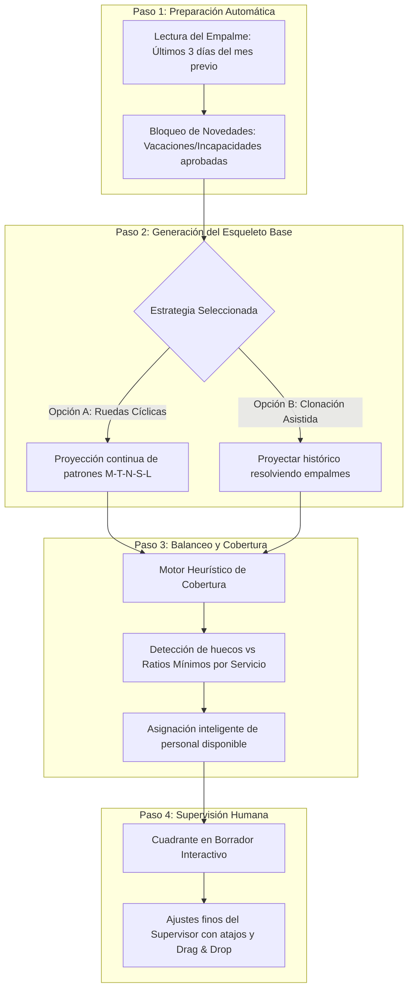
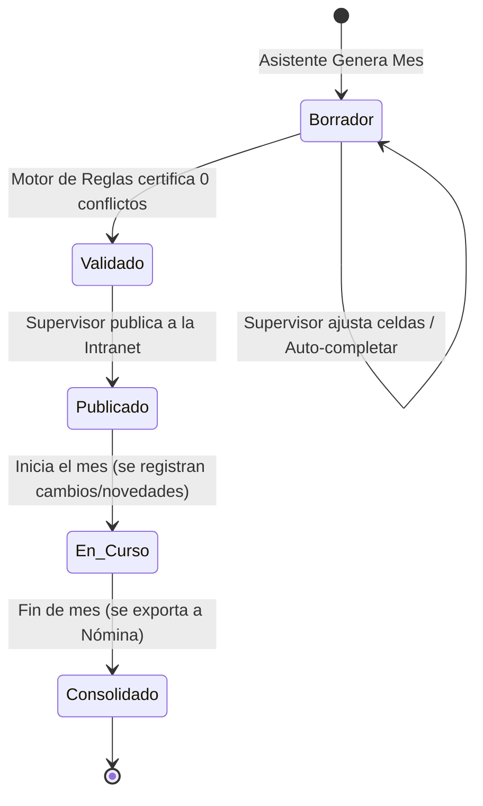

# 07. Automatización en la Programación y Experiencia Intuitiva Mes a Mes

## 1. El Reto Operativo del Cambio de Mes en Hospitales
En la gestión sanitaria, los meses del calendario son divisiones administrativas artificiales: **el hospital nunca se detiene entre el 31 de un mes y el 1 del mes siguiente**.

### Los 4 Dolores Típicos del Supervisor al Planificar el Nuevo Mes
1. **El "Efecto Empalme" (Frontera entre meses)**:
   - Si una enfermera hizo turno de noche el día 31, **no puede** ingresar a turno de mañana el día 1 (se violaría el descanso obligatorio de 12h y la post-guardia).
2. **Calendario y Festivos Variables (Ley Emiliani en Colombia)**:
   - Cada mes tiene distinta cantidad de días (28, 30 o 31) y una distribución única de festivos y domingos que alteran los recargos y los requerimientos de guardia.
3. **Puntos Ciegos de Novedades**:
   - Asignar turnos a personal que ya tiene programadas vacaciones, licencias o cursos formativos para el mes entrante.
4. **Inequidad Acumulada**:
   - Quien trabajó más fines de semana o noches en el mes anterior no debería repetir la misma carga pesada en el nuevo mes.

---

## 2. Los 3 Niveles de Automatización Asistida

Para que el sistema sea confiable y adoptado con agrado por los coordinadores médicos y jefes de enfermería, la automatización debe ser **asistida y transparente** (no una "caja negra" incomprensible):



### Nivel 1: Clonación Inteligente con Corrección de Empalme
- Toma como referencia el cuadrante del mes anterior, pero **no copia a ciegas**:
  - Revisa automáticamente el último día del mes saliente.
  - Si el día 31 fue `N` (Noche) o `G12/24` (Guardia), fuerza el día 1 del nuevo mes a `S` (Saliente) o `L` (Libre).
  - Borra las asignaciones en días donde el personal tenga vacaciones o licencias programadas en la Intranet.

### Nivel 2: Ruedas Rotativas Continuas (Patrones Sanitarios)
- Es el modelo predilecto de Thurni: El personal se organiza en cohortes o grupos (ej. Grupo A, B, C, D, E).
- Cada grupo sigue una secuencia cíclica predefinida (ej. Rueda de 5 semanas: `M - M - T - T - N - S - L - L ...`).
- El ciclo **no se reinicia el día 1**: continúa fluidamente desde el punto exacto donde terminó el ciclo en el mes previo.

### Nivel 3: Asignador Heurístico de Coberturas (Autocompletar Huecos)
- Si tras proyectar la rueda quedan vacantes (ej. por vacaciones de una enfermera jefe), el motor:
  1. Identifica qué personal de esa misma categoría está libre (`L`) ese día.
  2. Filtra solo a quienes cumplan con el descanso previo de 12h y descanso posterior.
  3. Ordena a los candidatos según **equidad de horas acumuladas** (priorizando a quien lleve menos horas en el mes).
  4. Asigna el turno o lo sugiere como recomendación de 1 clic al supervisor.

---

## 3. Experiencia de Usuario Intuitiva (UX en Angular)

Para que el planificador sea ágil, la interfaz no debe comportarse como un formulario web tradicional, sino como una **hoja de cálculo viva de grado clínico**:

### A. Asistente de Nuevo Mes (Modal Wizard de 3 Pasos)
Al iniciar la planificación del mes siguiente (ej. Julio):
1. **Paso 1: Diagnóstico de Empalme**: Muestra un resumen visual de cómo cierran los colaboradores en Junio (quiénes terminan en guardia nocturna y quedan protegidos los primeros días).
2. **Paso 2: Confirmación de Novedades**: Sincroniza desde la Intranet las vacaciones y permisos ya aprobados para Julio.
3. **Paso 3: Un Clic para Generar Borrador**: El usuario elige la estrategia (Rueda Cíclica o Proyección) y el sistema llena el 90% del cuadrante en segundos.

### B. Herramientas de Edición Rápida (Estilo Thurni)
- **Modo Teclado Ultra-rápido**:
  - El supervisor se desplaza por las celdas con las teclas de flecha (`←`, `↑`, `→`, `↓`).
  - Al pulsar una tecla (`M`, `T`, `N`, `L`, `S`, `G`), la celda se asigna de inmediato y el cursor avanza al día siguiente.
- **Herramienta Pincel / Relleno**:
  - Seleccionar un turno (ej. `M`) y arrastrar con el cursor sobre una fila completa para asignar una semana de mañanas sin soltar el clic.
- **Menú Contextual Inteligente (Clic derecho en celda)**:
  - Muestra solo las opciones válidas para ese colaborador en ese día, con etiquetas que explican advertencias (ej. *"Noche: No recomendado, descansaría solo 8h"*).

### C. Paneles Reactivos en Tiempo Real (Angular Signals)

```text
┌────────────────────────────────────────────────────────────────────────────────────────┐
│ [Dependencia: Urgencias Adultos]  [Periodo: Julio 2026]  [Estado: BORRADOR]  [🤖 Auto] │
├──────────────────────┬───┬───┬───┬───┬───┬───┬───┬─────────┬────────┬─────────────────┤
│ Personal / Cargo     │ 1 │ 2 │ 3 │ 4 │ 5 │ 6 │ 7 │ ... 31  │ Total  │ Balance Horas   │
├──────────────────────┼───┼───┼───┼───┼───┼───┼───┼─────────┼────────┼─────────────────┤
│ Dra. Ana Pérez (Esp) │ M │ M │ T │ T │ L │ L │ G │ ...     │ 176 h  │  0 h (Cumple)   │
│ Dr. Carlos Ruiz (Esp)│ T │ T │ L │ L │ N │ S │ L │ ...     │ 184 h  │ +8 h (Alerta) ⚠️│
│ Enf. Diana Mora (Jef)│ N │ S │ M │ M │ T │ L │ L │ ...     │ 168 h  │ -8 h (Déficit)  │
├──────────────────────┼───┼───┼───┼───┼───┼───┼───┼─────────┼────────┼─────────────────┤
│ COBERTURA MAÑANA (M) │ 3 │ 3 │ 2 │ 3 │ 3 │ 2 │ 1 │ ...     │ Mín: 3 │ 🔴 Día 3: Faltan│
│ COBERTURA TARDE  (T) │ 2 │ 2 │ 3 │ 2 │ 2 │ 2 │ 2 │ ...     │ Mín: 2 │ 🟢 100% Cubierto │
│ COBERTURA NOCHE  (N) │ 2 │ 2 │ 2 │ 2 │ 2 │ 2 │ 2 │ ...     │ Mín: 2 │ 🟢 100% Cubierto │
└──────────────────────┴───┴───┴───┴───┴───┴───┴───┴─────────┴────────┴─────────────────┘
```

1. **Footer de Cobertura en Vivo (Semáforo Dinámico)**:
   - Al pie de la grilla, filas fijas que calculan en tiempo real la cantidad de personas asignadas vs la cobertura requerida.
   - Verde: Cobertura satisfecha.
   - Rojo: Falta personal (al hacer clic en el número rojo, el sistema sugiere a quién asignar).
2. **Sidebar / Columnas de Balance a la Derecha**:
   - Cada empleado muestra sus horas mensuales acumuladas frente a su jornada legal pactada (Ley 2101).
   - Conteo de Noches trabajadas y Fines de semana trabajados para vigilar equidad.
3. **Barra de Conflictos y Validación (Floating Alert Bar)**:
   - Muestra el conteo de incidencias en vivo: *"2 infracciones detectadas"*.
   - Al hacer clic, hace zoom y scroll a la celda infractora con un botón de *"Auto-corregir"*.

---

## 4. Ciclo de Vida del Cuadrante Mensual



- **Borrador**: Solo visible para el planificador/supervisor del servicio.
- **Validado**: El motor certifica que no hay vacíos en coberturas ni violaciones a descansos legales.
- **Publicado**: Visible de inmediato para el personal en el portal del empleado y la intranet. Notifica cambios relevantes.
- **En Curso**: Se permiten permutas de turnos 1-a-1 y registro de bajas sobrevenidas con visto bueno del supervisor.
- **Consolidado / Cerrado**: Se bloquea toda edición; se liquidan horas ordinarias, recargos nocturnos y dominicales para envío a Nómina/RRHH.
