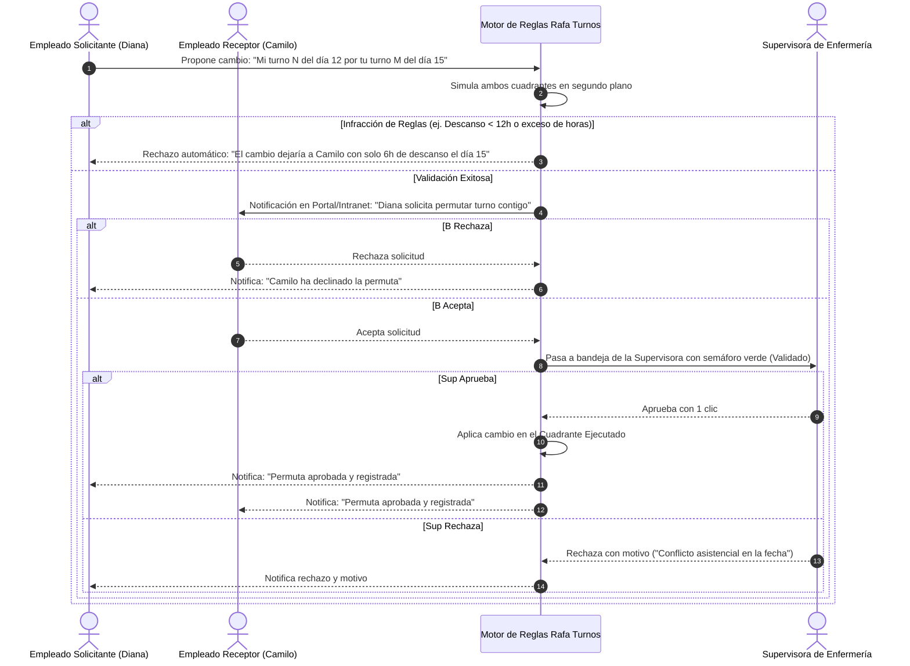
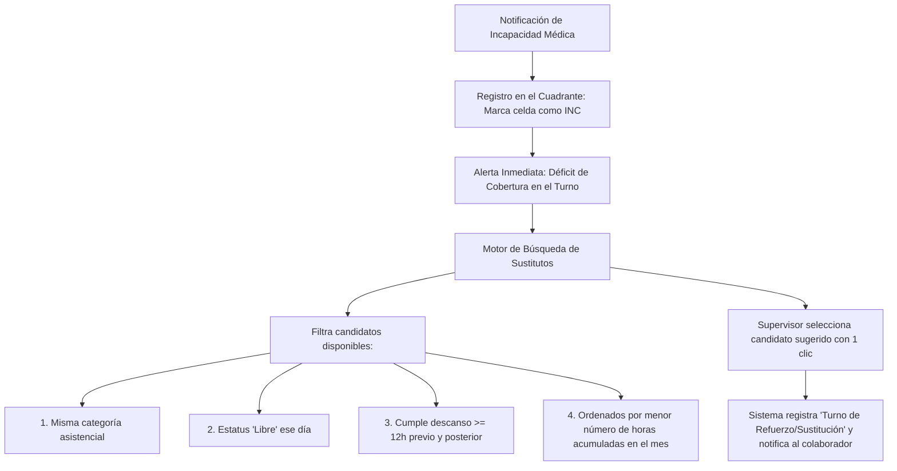

# 09. Flujos de Incidencias, Permutas y Sustituciones

## 1. La Realidad Operativa: Lo que Sucede Durante el Mes
El cuadrante mensual planificado y publicado casi nunca se ejecuta al 100% como fue previsto. En el entorno hospitalario surgen eventos diarios:
- **Ausencias imprevistas de última hora**: Un enfermero amanece enfermo con incapacidad a las 05:30 AM para el turno de las 07:00 AM.
- **Intercambios acordados entre compañeros (Permutas)**: Un médico requiere cambiar su guardia del domingo por un compromiso personal.
- **Necesidades sobrevenidas de refuerzo**: Un pico epidemiológico en Urgencias exige abrir 3 camas adicionales de reanimación y sumar 2 auxiliares.

---

## 2. Flujo 1: Intercambio de Turnos 1-a-1 (Permutas entre Pares)

Este flujo empodera al personal y reduce drásticamente las llamadas y quejas a Gestión Humana:

### Reglas Clave de la Permuta
1. **Misma Categoría Profesional y Servicio**: Una enfermera jefe solo puede permutar con otra enfermera jefe con competencias activas en el mismo servicio.
2. **Equilibrio de Horas**: El sistema advierte si el cambio genera un desbalance patrimonial de horas al cierre de mes entre ambos colaboradores.
3. **Plazo Límite de Solicitud**: Configurable (ej. mínimo 24 o 48 horas de antelación, salvo excepciones forzadas por la supervisora).

---

## 3. Flujo 2: Ausencias Imprevistas y Bolsa de Refuerzos

Cuando un colaborador notifica una baja médica repentina:

### Registro de la Sustitución
- El sistema no borra al empleado ausente: la celda original se marca con la novedad (`INC`), y el sistema inserta el turno de refuerzo al empleado disponible.
- Se preserva la causa: queda constancia de que fue un refuerzo de contingencia para justificar el pago de recargo u horas complementarias ante Gestión Humana.

---

## 4. Flujo 3: Solicitud de Vacaciones y Días de Libre Disposición

- El colaborador solicita su periodo de vacaciones desde el portal.
- El sistema proyecta el impacto en el cuadrante:
  - Muestra a la supervisora si en ese rango de fechas ya hay otros miembros del equipo en vacaciones (para evitar dejar el servicio sin masa crítica).
- Una vez aprobadas por RRHH en la Intranet, las fechas se bloquean con la ficha `VAC` en el cuadrante de Rafa Turnos de forma automática e irreversible para el planificador manual.
