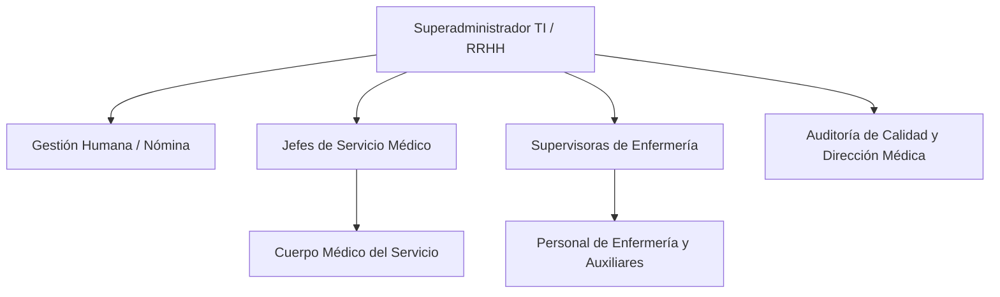

# 11. Matriz de Roles, Permisos y Seguridad (RBAC Hospitalario)

## 1. Principio de Mínimo Privilegio en el Entorno Hospitalario
En una institución de salud, los permisos deben ser altamente granulares y segmentados por **Dependencia / Servicio**: una supervisora de Urgencias no debe poder modificar el cuadrante de Quirófano, y un médico especialista no debe tener acceso a alterar cuadrantes ajenos.

---

## 2. Definición de Roles del Sistema

1. **Superadministrador (TI / Dirección RRHH)**:
   - Control total de la plataforma.
   - Configuración de conexión con la Intranet (SSO y endpoints).
   - Parametrización global de tipos de turnos y convenios legales.
2. **Gestión Humana / Especialista de Nómina**:
   - Visibilidad consolidada de todos los servicios hospitalarios.
   - Gestión y auditoría de la bolsa de horas y recargos.
   - Autoridad exclusiva para ejecutar el **Cierre Mensual** y exportar a nómina.
3. **Jefe de Servicio / Coordinador de Especialidad** (ej. Jefe de UCI o Cirugía):
   - Responsable de la planificación de los facultativos y médicos de su servicio.
   - Valida permutas y coberturas médicas.
4. **Supervisora de Enfermería** (asignada a una o varias dependencias):
   - Diseña y mantiene los cuadrantes de enfermeros jefes, auxiliares y camilleros de sus servicios asignados.
   - Aprueba solicitudes de intercambio y gestiona sustituciones de última hora.
5. **Personal Asistencial (Médicos, Enfermería, Auxiliares)**:
   - Consulta de su cuadrante personal y del cuadrante general de su servicio (para saber con qué compañeros trabaja en cada turno).
   - Propone y acepta permutas de turnos.
   - Solicita permisos o vacaciones.
6. **Auditoría de Calidad / Dirección Médica**:
   - Rol de solo lectura analítica: supervisa el cumplimiento de los estándares de acreditación en salud (ratios mínimos enfermero/paciente y descansos de seguridad).

---

## 3. Matriz Granular de Permisos (CRUD)

| Acción / Módulo | Superadmin | Gestión Humana | Jefe / Supervisora | Personal Asistencial | Auditor Calidad |
|---|:---:|:---:|:---:|:---:|:---:|
| **Crear / Editar Catálogo de Turnos** | ✅ | ✅ | ❌ | ❌ | ❌ |
| **Configurar Coberturas Mínimas** | ✅ | ✅ | ✅ (Su servicio) | ❌ | ❌ |
| **Generar Cuadrante Borrador** | ✅ | ✅ | ✅ (Su servicio) | ❌ | ❌ |
| **Editar Cuadrante (Arrastre / Paleta)**| ✅ | ❌ | ✅ (Su servicio) | ❌ | ❌ |
| **Publicar Cuadrante** | ✅ | ❌ | ✅ (Su servicio) | ❌ | ❌ |
| **Aprobar Permutas / Cambios de Turno**| ✅ | ❌ | ✅ (Su servicio) | ❌ | ❌ |
| **Proponer Permuta 1-a-1** | ❌ | ❌ | ❌ | ✅ (Entre pares) | ❌ |
| **Ver Cuadrante Publicado** | ✅ | ✅ | ✅ | ✅ (Su servicio) | ✅ |
| **Ejecutar Cierre de Mes (Nómina)** | ✅ | ✅ | ❌ | ❌ | ❌ |
| **Modificar Cuadrante Cerrado** | ✅ | ❌ (Solo reapertura) | ❌ | ❌ | ❌ |
| **Exportar Horas y Recargos** | ✅ | ✅ | ✅ (Su servicio) | ❌ | ✅ |
| **Ver Bitácora Forense de Auditoría** | ✅ | ✅ | ✅ (Su servicio) | ❌ | ✅ |

---

## 4. Seguridad y Protección de Datos en Salud (Habeas Data)
- **Datos Médicos Sensibles**: Los motivos específicos o diagnósticos (CIE-10) de las incapacidades médicas **solo son visibles para Gestión Humana y Salud Ocupacional**. Para los compañeros y supervisores en el cuadrante, la celda únicamente muestra la etiqueta genérica `INC` (Incapacidad Médica), protegiendo la confidencialidad médica del colaborador.
- **Tokens de Sesión Acotados**: La sesión transferida desde la Intranet incluye en el payload JWT el array de dependencias permitidas para el usuario (`allowedServices: [uuid1, uuid2]`), el cual es verificado por NestJS mediante decoradores (`@Roles()` y `@Services()`) y Guards de ruta.
