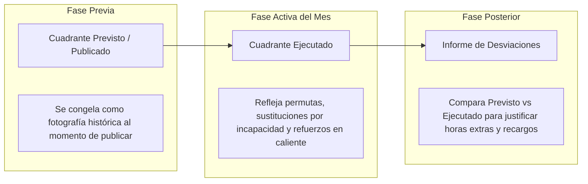

# 12. Versionado, Auditoría y Trazabilidad Legal

## 1. Importancia Médico-Legal del Cuadrante Hospitalario
En el ámbito de la salud, el cuadrante de turnos es un **documento médico-legal auditado**:
- Ante un evento adverso clínico o una demanda de responsabilidad civil médica, la fiscalía, el Ministerio de Salud o las aseguradoras exigen saber con certeza:
  1. ¿Quién estaba programado originalmente para estar a cargo del paciente?
  2. ¿Quién estuvo realmente en el turno (asistencia ejecutada)?
  3. Si hubo un cambio de última hora, ¿quién lo autorizó, cuándo y bajo qué justificación?

---

## 2. Los Dos Estados del Cuadrante: Previsto vs. Ejecutado

1. **Cuadrante Previsto (Planificado)**:
   - Es la versión original aprobada y publicada antes del inicio del mes.
   - Sirve de referencia para evaluar la adherencia a la planificación y el absentismo imprevisto.
2. **Cuadrante Real / Ejecutado**:
   - Es el registro vivo que incorpora las novedades del día a día (sustituciones, permutas de turnos entre compañeros, refuerzos).
   - Es la base exclusiva que se envía a Nómina para el pago de recargos y salarios.

---

## 3. Bitácora Forense de Auditoría (Audit Log)

Toda mutación que ocurra sobre el cuadrante (especialmente una vez publicado) genera un registro inmutable en la tabla de auditoría con la siguiente estructura:

| Campo | Tipo | Ejemplo | Justificación |
|---|---|---|---|
| `id` | UUID | `e3b0c442-...` | Identificador único de auditoría |
| `timestamp` | TimestampTZ | `2026-08-14 21:15:03 -05:00` | Momento exacto del cambio |
| `actor_id` | Foreign Key | `usr_supervisora_diana` | Quién realizó la acción |
| `ip_address` | String | `192.168.1.45` | Dirección IP de red hospitalaria |
| `empleado_id` | Foreign Key | `emp_camilo_lopez` | Colaborador afectado |
| `dependencia_id` | Foreign Key | `dep_uci_adultos` | Servicio hospitalario |
| `fecha_turno` | Date | `2026-08-15` | Día del turno modificado |
| `turno_anterior` | String | `L` (Libre) | Estado previo |
| `turno_nuevo` | String | `N` (Noche) | Estado resultante |
| `origen_cambio` | Enum | `SUSTITUCION_INCAPACIDAD` | Permuta, Asistente, Drag & Drop manual |
| `justificacion` | Text | `Reemplazo urgente por baja médica de Enf. Gómez` | Motivo clínico/operativo obligatorio |

---

## 4. Comparador de Versiones (Diff Visual en Angular)
Para que Gestión Humana y la Dirección Médica auditen con facilidad:
- La interfaz permite activar el botón **"Ver Cambios vs Previsto"**:
  - Las celdas que no sufrieron variaciones se muestran en color estándar.
  - Las celdas modificadas muestran un pequeño triángulo amarillo en la esquina superior; al pasar el cursor (tooltip), se detalla el cambio:
    - *"Original: Libre (L) -> Ejecutado: Noche (N) por Permuta #42 aprobada por Sup. Diana el 12/08"*.
