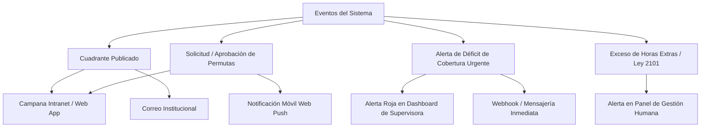

# 13. Sistema de Notificaciones, Comunicaciones y Alertas

## 1. El Rol de las Notificaciones en la Operación Sanitaria
La programación de turnos solo es efectiva si el personal se entera oportunamente de sus asignaciones y si los coordinadores son alertados antes de que un déficit de personal afecte la atención de los pacientes.

---

## 2. Matriz de Eventos y Canales de Notificación

### Clasificación de Eventos

| Evento | Destinatario | Canal Primario | Canal Secundario | Nivel de Urgencia |
|---|---|---|---|---|
| **Publicación de Cuadrante** | Todos los colaboradores del servicio | Campana en Intranet | Correo institucional con resumen del mes | Medio |
| **Petición de Permuta Recibida** | Compañero receptor | Notificación en Portal / Web Push | Correo | Medio |
| **Permuta Resuelta (Aprobada/Rechazada)** | Solicitante y Receptor | Notificación en Portal | Actualización de calendario | Bajo |
| **Déficit de Cobertura Sobrevenido (Baja médica)**| Supervisora de Enfermería y Jefe de Servicio | Banner Rojo persistente en Dashboard | Alerta inmediata por correo / Webhook | **Crítico (Inmediato)** |
| **Alerta Preventiva de Descanso < 12h** | Supervisor al momento de arrastrar turno | Tooltip modal en la cuadrícula | No aplica (Feedback síncrono) | Alto |
| **Alerta de Horas Extras Excedidas** | Gestión Humana / Nómina | Semáforo de advertencia en el informe | Notificación semanal consolidada | Medio |

---

## 3. Integración con la Campana de la Intranet
Dado que **Rafa Turnos** es un satélite de la Intranet:
- Cuando se publica un cuadrante o se aprueba un cambio, el backend en NestJS emite un evento al sistema de notificaciones de la Intranet vía API REST o Webhook:
  - `POST /api/v1/notificaciones` (payload con título, mensaje, usuario destino y enlace directo `https://intranet.hospital.com/turnos/mis-turnos`).
- De esta manera, el profesional ve la notificación unificada en la campana principal de la Intranet donde consulta habitualmente sus circulares y recibos de nómina.

---

## 4. Sincronización con Calendarios Personales (iCal / Google Calendar)
- Desde el portal del empleado, cada profesional dispone de un enlace privado **iCal (`webcal://...`)**:
  - Permite suscribir su cuadrante de turnos a Google Calendar, Apple Calendar o Microsoft Outlook en su teléfono móvil personal.
  - Si una permuta es aprobada en el sistema, el calendario del móvil se actualiza automáticamente sin que el colaborador tenga que transcribir sus turnos a mano.
