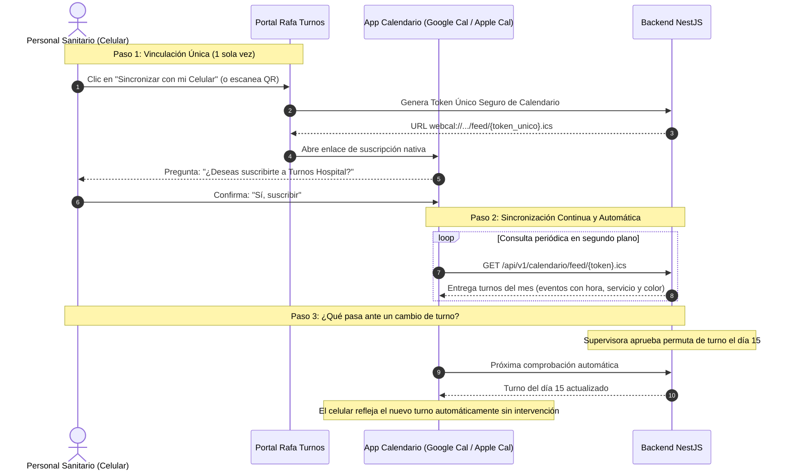

# 14. Arquitectura y Funcionamiento de la Sincronización Móvil

## 1. El Problema Cotidiano del Personal Sanitario
En los hospitales, el personal médico y de enfermería tiene turnos rotativos atípicos (mañanas, tardes, noches de 12 horas, guardias de fin de semana). 
El método tradicional de tomarle una foto al cuadrante de papel o transcribir a mano cada turno en el calendario del celular causa:
- Errores humanos (confundir un turno de mañana con uno de tarde).
- Desactualización ante cambios de última hora (si la supervisora aprueba una permuta, la foto del celular queda obsoleta).
- Cruces con la vida familiar y personal.

---

## 2. La Solución: Suscripción Dinámica de Calendario (Estándar iCalendar / `webcal://`)

En lugar de obligar al personal a instalar una aplicación pesada desde Google Play o App Store, **Rafa Turnos** utiliza el estándar mundial **RFC 5545 (iCalendar / Webcal)**. Es el mismo protocolo que utilizan aerolíneas, eventos deportivos y plataformas líderes como Thurni.



---

## 3. ¿Cómo lo experimenta el Colaborador en su Teléfono?

### En iPhone (Apple Calendar)
1. El colaborador abre el portal de Rafa Turnos desde su iPhone (Safari o Chrome).
2. Toca el botón **"Sincronizar con mi iPhone"**.
3. El sistema operativo iOS despliega una ventana del sistema:
   > *"¿Deseas añadir la suscripción al calendario 'Turnos UCI - Diana Mora'?"*
4. El colaborador toca **Añadir**.
5. **Resultado**: Todos sus turnos aparecen coloreados en la app nativa de Calendario de su iPhone, junto a sus citas personales, con alertas previas (ej. "Recordatorio: Turno Noche hoy a las 19:00").

### En Android (Google Calendar)
1. El colaborador escanea un código QR desde la pantalla o toca **"Añadir a Google Calendar"**.
2. Google Calendar suscribe la URL a su cuenta de Gmail (`@gmail.com` o correo corporativo).
3. **Resultado**: Los turnos se sincronizan con la app de Google Calendar de su teléfono Android, smartwatch o asistente de voz.

---

## 4. ¿Qué Información Contiene Cada Evento en el Calendario?

Cuando el médico o enfermero toca un turno en su celular, ve una ficha completa y clara:

```text
┌────────────────────────────────────────────────────────┐
│  🌙 Turno Noche (N) - UCI Adultos                      │
├────────────────────────────────────────────────────────┤
│  📅 Viernes, 14 de Agosto de 2026                      │
│  ⏰ 19:00 - 07:00 (+1 día) (12 horas)                  │
│                                                        │
│  🏥 Ubicación: Hospital Central - Piso 3 (UCI)         │
│  📋 Notas del Turno:                                   │
│     • Tipo: Noche asistencial                          │
│     • Recargo: Aplica recargo nocturno y festivo       │
│     • Supervisora a cargo: Enf. Diana Mora             │
│     • Estado: Cuadrante Publicado                      │
│                                                        │
│  🔔 Recordatorio: 2 horas antes (17:00)                │
└────────────────────────────────────────────────────────┘
```

---

## 5. Ventajas Técnicas y de Seguridad

1. **Cero Mantenimiento en Tiendas de Apps**:
   - No requiere pagar cuentas de desarrollador de Apple ($99 USD/año) ni de Google, ni esperar días por aprobaciones de revisiones de apps.
2. **Impacto Cero en la Batería del Móvil**:
   - La sincronización la gestiona directamente el sistema operativo del teléfono (iOS / Android) usando sus rutinas nativas y optimizadas de ahorro de energía.
3. **Consulta Offline (Sin Internet)**:
   - Una vez descargado el mes, el colaborador puede ver sus turnos en su teléfono aunque no tenga señal celular ni datos móviles en el sótano del hospital.
4. **Seguridad y Revocación (Tokens Criptográficos)**:
   - Cada enlace de suscripción utiliza un token aleatorio y seguro (UUID v4 / hash criptográfico).
   - No se envían contraseñas ni datos sensibles en la URL.
   - Si el empleado extravía su teléfono o se retira del hospital, Gestión Humana o el propio empleado pulsa **"Revocar enlace"** y el calendario deja de actualizarse inmediatamente.

---

## 6. Complemento: Web App Progresiva (PWA) para Acciones Activas
El calendario móvil (`webcal`) es ideal para **consultar**. Pero si el colaborador desea **actuar** desde su móvil (por ejemplo: pedir una permuta o aceptar el turno de un compañero):
- El frontend en **Angular** se diseña como **PWA (Progressive Web App)** con diseño adaptativo (responsive).
- Permite pulsar *"Agregar a la pantalla de inicio"* en el celular, quedando con el ícono de **Rafa Turnos** como si fuera una aplicación nativa, rápida y ligera.
