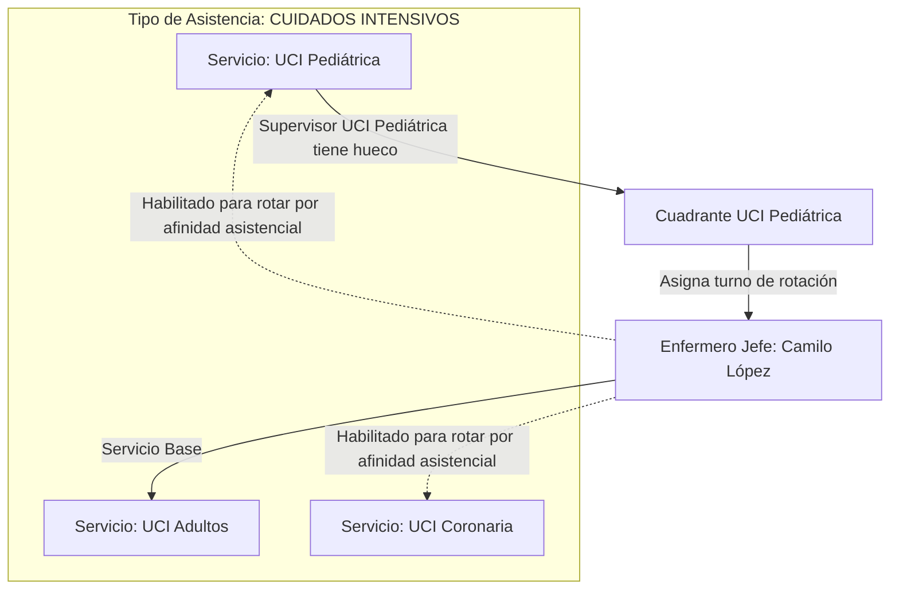

# 17. Modelo de Rotación de Personal entre Servicios Asistenciales Homólogos

## 1. Principio Clínico: Rotación por Afinidad Asistencial
En las instituciones de salud, los colaboradores no pueden rotar a cualquier servicio indiscriminadamente: un auxiliar de Consulta Externa no puede cubrir una guardia en UCI por exigencias de bioseguridad y competencias clínicas.

Sin embargo, el personal **sí puede y suele rotar entre servicios que comparten el mismo tipo de asistencia o complejidad**:
- **Bloque Crítico / Cuidados Intensivos**: Colaboradores que rotan entre *UCI Adultos*, *UCI Pediátrica*, *UCI Coronaria* o *Unidad de Quemados*.
- **Bloque de Urgencias**: Rotación entre *Urgencias Generales*, *Triage*, *Urgencias Pediátricas* y *Observación*.
- **Bloque Quirúrgico**: Rotación entre *Quirófanos Centrales*, *Cirugía Ambulatoria* y *Recuperación (URPA)*.
- **Bloque de Hospitalización**: Rotación entre *Hospitalización Piso 2*, *Piso 3* y *Piso 4*.

---

## 2. Mecanismo de Configuración en el Sistema

### A. Atributo `tipoAsistencia` en cada Servicio
Cada servicio hospitalario se clasifica en un grupo asistencial homogéneo:
- `CUIDADOS_INTENSIVOS`
- `URGENCIAS`
- `QUIRURGICO`
- `HOSPITALIZACION`
- `APOYO_DIAGNOSTICO`
- `CONSULTA_EXTERNA`

### B. Habilitación de Rotación
Un empleado puede ser programado en un servicio diferente a su servicio base si:
1. El servicio destino comparte el mismo `tipoAsistencia` que su servicio base (o el empleado tiene una habilitación especial aprobada por Gestión Humana).
2. El colaborador tiene la misma `CategoriaProfesional` requerida (ej. Enfermero Jefe con Enfermero Jefe).
3. No tiene asignado ningún turno ese mismo día en su servicio base ni en ningún otro (`un_turno_por_empleado_y_dia`).
4. Cumple con el descanso ininterrumpido de 12 horas y la post-guardia reglamentaria.

---

## 3. Experiencia Visual en los Cuadrantes (UX)

### A. Para el Supervisor del Servicio Destino (ej. UCI Pediátrica)
- Al abrir la paleta para cubrir un hueco, el selector de personal muestra:
  - **Personal de Planta del Servicio** (adscritos a UCI Pediátrica).
  - **Personal Homólogo Disponible** (colaboradores de UCI Adultos o Coronaria que están libres `L` ese día y cumplen con las 12h de descanso).
- Al asignarlo, el sistema marca el turno con un distintivo visual (ej. icono de intercambio 🔄 o etiqueta *"Rotación: Base UCI Adultos"*).

### B. Para el Supervisor del Servicio Base (ej. UCI Adultos)
- En el cuadrante de UCI Adultos, la celda de ese día para Camilo no se ve vacía:
  - Muestra una ficha de color atenuado con el rótulo: **`[ UCI-PED: N ]`** (*"En rotación en UCI Pediátrica"*).
  - La celda queda **bloqueada** para el supervisor de UCI Adultos, evitando que intente programarlo simultáneamente.

### C. Para Nómina y Gestión Humana
- En el reporte consolidado de horas de fin de mes:
  - Las horas laboradas suman al total contractual del empleado.
  - El reporte desglosa el **Servicio Ejecutor** de cada turno, permitiendo a Nómina imputar los costos y recargos al centro de costos correcto del hospital.
