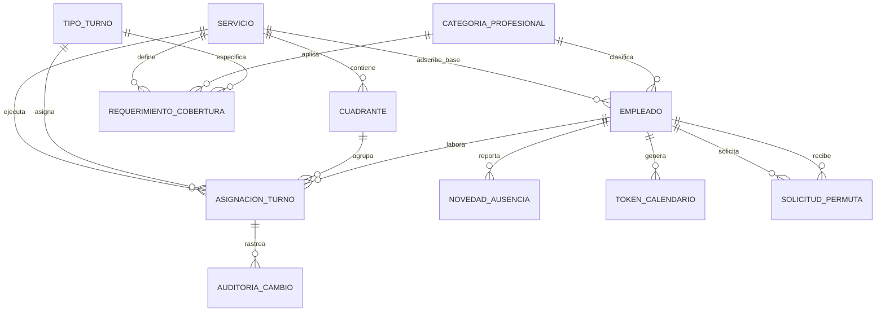

# 01. Modelo de Datos Relacional y Esquema Prisma (PostgreSQL)

## 1. Visión General del Modelo
El modelo de datos relacional de **Rafa Turnos** adopta un diseño plano, directo y asistencial:
- **Estructura Directa por Servicios**: Se elimina la burocracia de "dependencias, procesos y subprocesos". La unidad organizativa y clínica fundamental es el **Servicio** (ej. *Urgencias Generales*, *UCI Adultos*, *UCI Pediátrica*, *Cirugía General*, *Hospitalización Piso 3*, *Laboratorio Clínico*).
- **Rotación entre Servicios Homólogos (`tipoAsistencia`)**: Los servicios se clasifican por su alcance clínico (ej. `CUIDADOS_INTENSIVOS`, `URGENCIAS`, `HOSPITALIZACION`). Los profesionales pueden rotar entre servicios que compartan el mismo `tipoAsistencia`.
- **Rendimiento Extremo en la Matriz Mensual**: Índices compuestos en `(cuadranteId, fecha)` y `(empleadoId, fecha)` que permiten renderizar meses completos de hasta 100 empleados en milisegundos.
- **Sincronización Desacoplada con la Intranet**: Campos `intranetId` indexados en `servicios` y `empleados` para consulta y refresco inmediato.
- **Desglose Legal de Tiempos (CST Colombia)**: Cada asignación de turno almacena tanto el código visual (`M`, `T`, `N`, etc.) como el desglose exacto de horas (`hod`, `hon`, `hdfd`, `hdfn`, `hed`, `hen`), permitiendo exportar el reporte a Nómina a tiempo constante $O(1)$.
- **Trazabilidad Médico-Legal Inmutable**: Tabla `auditorias_cambio` que registra quién, cuándo y por qué se alteró cada celda del cuadrante.

---

## 2. Diagrama Entidad-Relación Detallado

---

## 3. Diccionario de Entidades Principales

### A. Estructura Asistencial y Maestros Sincronizados
- **`Servicio`** (tabla `servicios`): Unidad asistencial autónoma del hospital.
  - `tipoAsistencia`: Clasificación del servicio (ej. `CUIDADOS_INTENSIVOS`, `URGENCIAS`, `HOSPITALIZACION`, `QUIRURGICO`). Habilita la rotación entre servicios con afinidad asistencial idéntica.
  - `intranetId`: Llave de enlace con la Intranet.
- **`CategoriaProfesional`** (tabla `categorias_profesionales`): Roles clínicos (Médico Especialista, Enfermero Jefe, Auxiliar de Enfermería). Fundamental para validar que las permutas solo se hagan entre pares equivalentes.
- **`Empleado`** (tabla `empleados`): Colaboradores hospitalarios con `intranetId`, documento (Cédula), nombres, correo, `servicioBaseId` y jornada semanal legal (Ley 2101).

### B. Catálogo de Turnos y Coberturas
- **`TipoTurno`** (tabla `tipos_turno`): Catálogo cromático (`M`, `T`, `N`, `G12`, `G24`, `S`, `L`). Especifica franjas horarias, duración en horas y color HEX para la paleta de la interfaz estilo Thurni.
- **`RequerimientoCobertura`** (tabla `requerimientos_cobertura`): Reglas de dotación mínima por servicio, turno, categoría profesional y tipo de día (ordinario vs dominical/festivo).

### C. Cuadrantes y Asignaciones Diarias (Con Soporte de Rotación)
- **`Cuadrante`** (tabla `cuadrantes`): Unidad mensual de planificación (`anio`, `mes`, `servicioId`, `estado`: `BORRADOR`, `VALIDADO`, `PUBLICADO`, `CERRADO_NOMINA`).
- **`AsignacionTurno`** (tabla `asignaciones_turno`): La celda individual de la matriz.
  - `cuadranteId`: Cuadrante al que pertenece la fila.
  - `servicioEjecutorId`: Servicio clínico donde se labora el turno en realidad.
  - `esRotacion`: Indicador booleano (True si el turno se realizó en un servicio diferente a su base).
  - Desglose exacto de horas (`hod`, `hon`, `hdfd`, `hdfn`, `hed`, `hen`).
  - Restricción de unicidad global: `@@unique([empleadoId, fecha])`.

### D. Flujos de Gestión, Novedades y Nómina
- **`SolicitudPermuta`**: Flujo de intercambio de turno 1-a-1 entre compañeros con estados `PENDIENTE_PAR`, `PENDIENTE_SUPERVISOR`, `APROBADA`, `RECHAZADA`.
- **`NovedadAusencia`**: Registro de ausencias (`VAC` Vacaciones, `INC` Incapacidades) para bloquear celdas y evitar asignaciones erróneas.
- **`AuditoriaCambio`**: Registro forense inmutable de modificaciones de celdas una vez publicado el cuadrante.
- **`TokenCalendario`**: Tokens aleatorios y seguros para la sincronización móvil iCalendar (`webcal://`).
- **`FestivoColombia`**: Registro de días festivos oficiales colombianos para la aplicación de recargos dominicales/festivos.
